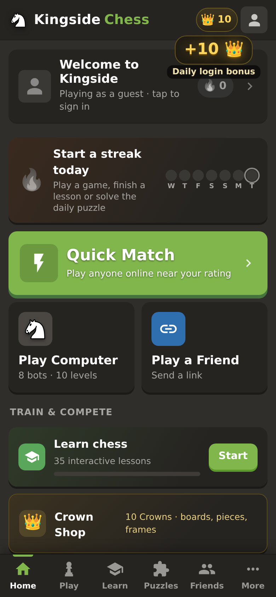
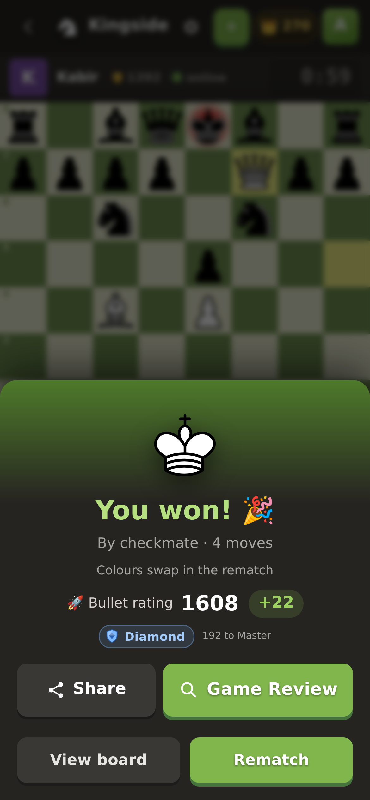
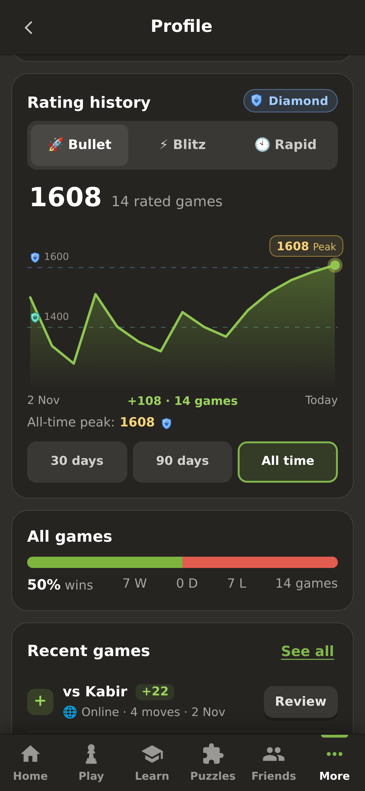
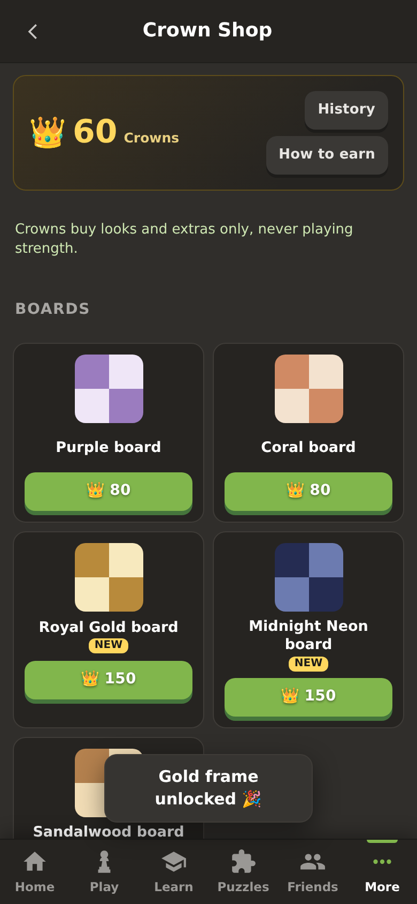

# ♞ Kingside Chess

**Play chess against bots from 250 to 3000+, or get rated online, in English or Hindi. Free, on the web, Android and Windows.**

Kingside Chess is a free chess app with a full ladder of bots (from Chintu at 250 up to Titan at 3000+, powered by Stockfish 19), online Quick Match with real Glicko-2 ratings, Game Review that marks your Brilliant moves and blunders, puzzles, 35 interactive lessons and tournaments with friends. It runs in the browser as an installable PWA, as an Android app and as a Windows app, and the whole interface is available in Hindi.

**▶ Play now: https://sonujeet-chess.sites.tab.bot**
&nbsp;·&nbsp; **⬇ Download (Android / Windows): https://kingside-chess-app.sites.tab.bot**
&nbsp;·&nbsp; **🎮 itch.io: https://sonujeet.itch.io/kingside-chess**

<p>
  
  
  
  
</p>

## Features

- **Bots for every level:** from Chintu (250) to Titan (3000+), with human-like play at the low levels and Stockfish 19 at the top.
- **Online Quick Match** with **Glicko-2 ratings** (the system Lichess uses), and a separate rating for **Bullet, Blitz and Rapid**.
- **Rating after every game:** +/- change, rating graph per time control (30 days / 90 days / all time, peak marked) and a provisional "?" for new players.
- **Ranks:** Bronze, Silver, Gold, Platinum, Diamond, Master and Grandmaster, with a promotion celebration.
- **Game Review:** accuracy plus Brilliant, Great, inaccuracy, mistake and blunder marks, using Lichess's win-chance rules.
- **Puzzles:** Puzzle Rush with a leaderboard.
- **Learn:** 35 interactive lessons (basics, tactics, checkmate patterns, openings, endgames).
- **Hindi:** the whole app in English or हिन्दी.
- **Tournaments:** run a tournament with friends from a link.
- **Crowns 👑:** free coins earned by playing, spent in the Crown Shop on boards, piece sets, avatars and frames.
- Friends, challenges, share links, streaks and achievements.

## Repository layout

| Folder | What it is |
| --- | --- |
| `web-site/` | The deployable web app (Cloudflare Worker + D1). `worker.mjs` is built from `server/` with `server/build.sh`. |
| `server/` | Server source: rooms, tournaments, accounts, Quick Match, ratings, Crowns, share pages. |
| `android/` | Android WebView app: `build.sh` builds, `sign.sh` signs (keystore not included). |
| `windows/` | Electron Windows app (NSIS installer via electron-builder). |
| `itch/` | The itch.io browser build. |
| `download-page/` | The download landing page. |
| `test/` | Unit tests (`node --test`) and Playwright harness scripts. |

More detail per version is in [`README.txt`](README.txt).

## Build

```sh
# web: build the worker from server/ (needs esbuild)
cd server && npm install && ./build.sh

# Android (Android SDK build-tools 36.1.0, platform 36)
android/sync-www.sh && android/build.sh
KS=/path/to/release.keystore KS_PASS=... android/sign.sh

# Windows
cd windows && ./sync-www.sh && npm install && npx electron-builder --win
```

Ready-made builds (APK and Windows installer) are on the [Releases](../../releases) page.

## License

Kingside Chess is free software under the **GNU GPL v3** ([LICENSE-GPLv3.txt](LICENSE-GPLv3.txt)); it bundles Stockfish (GPLv3). Piece sets, sounds and other assets are credited with their licences in [CREDITS.txt](CREDITS.txt).

---

Built with AI by **Sonujeet** (Mumbai).
